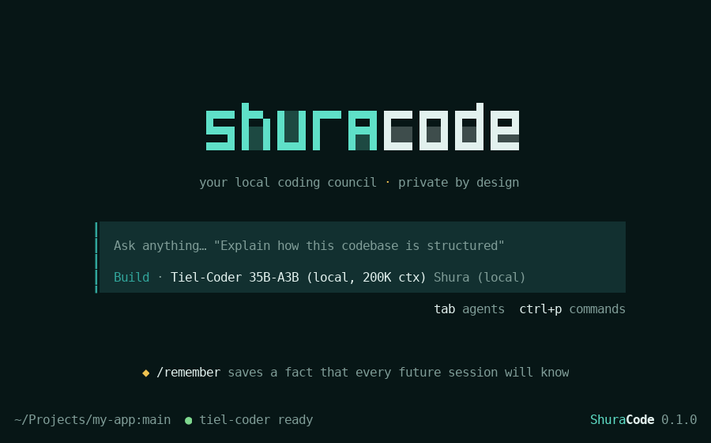
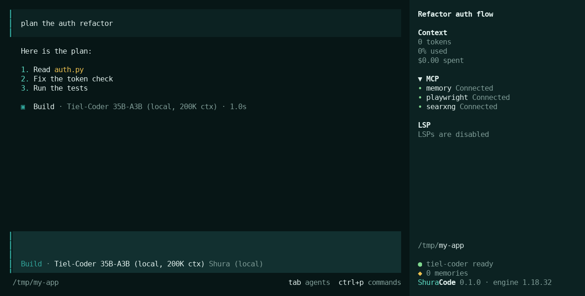

<div align="center">


# ShuraCode

**Терминалда бағдарламалауға арналған жеке локальды ЖИ-агент, оның жады сессиялар арасында сақталады.**

[English](README.md) · [Русский](README.ru.md) · Қазақша

</div>



> [!NOTE]
> **Рахмет.** ShuraCode өзгенің еңбегіне сүйеніп жасалған.
> [**OpenCode**](https://github.com/anomalyco/opencode) — оның қозғалтқышы, мұндағының бәрі соның үстіне
> тұрғызылған. [**thecodacus**](https://github.com/thecodacus) модельді бір GPU-да жылдам жұмыс істетін
> llama.cpp-тің `perf`-форкін жазды, ал оның [understory](https://github.com/thecodacus/understory)
> жобасы тұрақты жад идеясын берді. **peculiar-ragdoll** Tiel-Coder-ді жасады. Браузер мен веб-іздеу
> құралдары — [Playwright MCP](https://github.com/microsoft/playwright-mcp),
> [SearXNG](https://github.com/searxng/searxng) және [mcp-searxng](https://github.com/ihor-sokoliuk/mcp-searxng).

ShuraCode — [Shura](https://github.com/hikkian/shura) жобасының бағдарламалау агенті, Shura Tiel-Coder 35B
моделін өз GPU-ңызда іске қосады. Бәрі сіздің компьютеріңізде жұмыс істейді: модель де, агент те, оның жады да.

- **Тұрақты жад.** «Мен pytest-ті жақсы көремін деп есте сақта» деп айтыңыз, содан кейінгі әр сессия мұны
  біле жүреді. Жад — қарапайым markdown-файлдар, оларды оқуға, түзетуге және жоюға болады.
- **Екі режим.** **Build** өзгерістер енгізеді. **Plan** тек оқиды және ұсыныс жасайды, тіпті терминалдағы
  шығысты қайта бағыттау арқылы да ол ештеңе жаза алмайды. Ауыстыру — Tab пернесімен.
- **Командалар.** `/remember`, `/forget`, `/memory`, `/test`, `/commit`, `/review` және `/guide`: командалар мен пернелердің толық тізімі ағылшын, орыс немесе қазақ тілінде (сондай-ақ [docs/COMMANDS.md](docs/COMMANDS.md) файлында).
- **Модель статусы.** Экранның төменгі жағында локальды модельдің жүктелгені, жүктеліп жатқаны немесе
  ұйықтап тұрғаны көрінеді.
- **Әдепкіде офлайн.** Жаңартуды тексеру де, сессияларды жариялау да, модель каталогтарын жүктеу де,
  телеметрия да жоқ.



## OpenCode негізінде

ShuraCode [OpenCode](https://github.com/anomalyco/opencode) (MIT) негізінде жасалған, ол оған қозғалтқыш
қызметін атқарады. Бұл OpenCode-тың форкі емес: ShuraCode OpenCode-тың ашық кеңейту нүктелері арқылы өз қабатын
қосады.

| Қабат | Не қосады |
|---|---|
| `bin/shuracode` | команданы, өз баптау папкасын, офлайн-баптауларды және `shuracode` процесс атауын |
| `plugin/shuracode.tsx` | интерфейс плагині: логотип, төменгі жол, бүйір панелі, кеңестер, терезе тақырыбы, модель статусы |
| `plugin/server.ts` | серверлік плагин: агент өзін ShuraCode деп таныстырады |
| `mcp/memory.py` | жад сервері (тек Python стандартты кітапханасы) |
| `config/`, `commands/`, `themes/` | модельді қосу, қолжетімділік құқықтары, ережелер, командалар, тақырып |

Қозғалтқыштың ішінде ештеңе өзгертілмейді, сондықтан қозғалтқышты жаңарту ShuraCode-тың сыртқы түрін, атауын
және мүмкіндіктерін сақтайды. `shuracode update` жаңа қозғалтқышты қазіргісінің қасына орнатады және оған
өзін-өзі тексеруді іске қосады:

- логотип, төменгі жол және терезе тақырыбы орнында;
- агент өзін бұрынғыдай ShuraCode деп таныстырады және өзі жұмыс істеп тұрған модельдің атын атайды.

ShuraCode жаңа қозғалтқышқа тек барлық тексеру өткенде ғана ауысады. Біреуі өтпесе, сіз қазіргі нұсқада
қаласыз. `shuracode rollback` алдыңғы нұсқаны қайтарады.

## Орнату

Shura-мен бірге: `setup.sh` ShuraCode-ты өзі орнатады. Жеке орнату:

```bash
git clone https://github.com/hikkian/shuracode.git && cd shuracode
./install.sh                      # қозғалтқыш, баптаулар, жад, `shuracode` командасы
shuracode doctor                  # бәрі дұрыс екенін тексеру
```

Талаптар: Linux x86_64, Node.js 18+, Python 3.10+ және OpenAI-үйлесімді API арқылы қолжетімді модель.
Әдепкіде бұл Shura gateway-і, мекенжайы `http://127.0.0.1:8080/v1`. Басқа мекенжай:
`./install.sh --base-url URL --status-url ""`.

## Қолдану

```bash
cd your-project && shuracode      # интерфейсті ашу
shuracode run "src/app.py түсіндір"   # интерфейссіз бір сұраныс
shuracode update | rollback | doctor | version | help
```

| Команда | Не істейді |
|---|---|
| `/remember [дерек]` | деректі сақтайды; аргументсіз осы сессияда анықталған ең пайдалы нәрсені сақтайды |
| `/forget <тақырып>` | сәйкес жазбаны тауып, жояды; бірнешеуі сәйкес келсе, сұрайды |
| `/memory` | не сақталғанын көрсетеді және ескірген жазбалар мен көшірмелерді белгілейді |
| `/test` | жобада тесттер қалай іске қосылатынын анықтайды, іске қосады, құлағандарын түзетеді және нақты нәтижені көрсетеді |
| `/commit` | бір логикалық өзгерісті репозиторий стилінде коммит етеді; ешқашан push жасамайды және қол таңба қоспайды |
| `/review` | коммит етілмеген өзгерістерді (немесе коммитті, тармақты, PR-ды) тексереді |

## Жад

Әр жазба — `~/.local/share/shuracode/memory/` ішіндегі жеке markdown-файл. Әрқайсысының түрі бар:

- `user`: сіз кімсіз және қалай жұмыс істейсіз;
- `feedback`: түзетулер және расталған тәсілдер;
- `project`: кодта жоқ жоба туралы білім;
- `reference`: сілтемелер.

`MEMORY.md` мазмұны әр сессияға жүктеледі, сондықтан модель бірінші қадамға дейін-ақ нені есте
сақтайтынын біледі. Қысқа жазбалар мазмұнда толық көрінеді.

Модель жадпен төрт құрал арқылы жұмыс істейді (`memory_save`, `memory_read`, `memory_search`,
`memory_delete`). Жад сервері ережелердің орындалуын қадағалайды:

- бір дерек — бір файл;
- бар атпен сақтау жазбаны жаңартады;
- мазмұн әр өзгерістен кейін қайта құрастырылады;
- шектеулер: 100 жазба, әрқайсысында 2000 символға дейін;
- пароль немесе токенге ұқсайтын кез келген нәрсе қабылданбайды.

Нені қашан есте сақтау керегін [`config/AGENTS.md`](config/AGENTS.md) ішіндегі ережелер шешеді. Бөлек
«кітапханашы» моделі жоқ, сондықтан жад модельге артық сұраныс жұмсамайды. Дискіге тек жазба сақталғанда
немесе жойылғанда жазылады.

Tiel-Coder-де тексерілді: бір сессияда сақталған ереже үш жаңа сессияның үшеуінде де қолданылды.
Пайдаланушы ойын өзгерткенде бар жазба жаңарды, ал көшірме пайда болған жоқ. GitHub токенін сақтаудан бас
тартты.

## Build және Plan

| Режим | Файлдар | Терминал |
|---|---|---|
| Build | өңдеуге рұқсат | тесттер, git (push-тан басқасы) және тек оқуға арналған командалар сұрамай орындалады; қалғаны — растаумен; `rm -rf`, `mkfs`, `reboot` және осы сияқтылар тыйым салынған |
| Plan | өңдеуге тыйым салынған | сұрамай тек оқуға арналған командалар орындалады (`git status/diff/log/show`, `ls`, `cat`, `grep`, `rg`, `find` және т.б.); `>` немесе `tee` бар кез келген команда — растаумен; `find -delete` тыйым салынған |

Әр ереже былай тексерілді: тест моделі команданы орындауды сұрады, ал біз іс жүзінде не болғанын қарадық.

## Не қайда жатыр

| Жол | Не |
|---|---|
| `~/.config/shuracode/` | `shuracode.json`, `tui.json`, `AGENTS.md`, `commands/` |
| `~/.local/share/shuracode/engine/` | қазіргі және алдыңғы қозғалтқыш |
| `~/.local/share/shuracode/memory/` | жад (папка `0700`, файлдар `0600`) |
| `~/.local/bin/shuracode` | команда |

Сессиялар тарихы мен кэштерді қозғалтқыш өзінің стандартты папкаларында сақтайды
(`~/.local/share/opencode`, `~/.cache/opencode`), ал тақырыптың көшірмесі — `~/.config/opencode/themes`
ішінде.

## Шектеулер

- Қозғалтқыш ішкі командаларының `--help` анықтамасы мен кейбір сирек кездесетін диалогтар әлі де
  қозғалтқыштың атауын көрсетеді. Мұны өзгерту үшін форк қажет.
- Fedora 44-те Ghostty және GNOME-мен тексерілді. Linux-тің басқа дистрибутивтері мен терминалдар жұмыс
  істеуі тиіс, бірақ тексерілмеген.

## Лицензия

MIT, [LICENSE](LICENSE) файлын қараңыз. OpenCode өз авторларының MIT лицензиясымен таратылады, [NOTICE](NOTICE)
файлын қараңыз.
